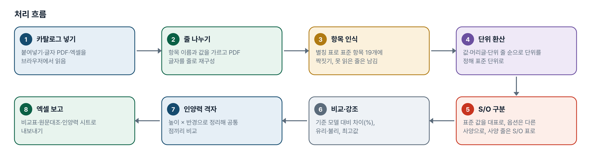
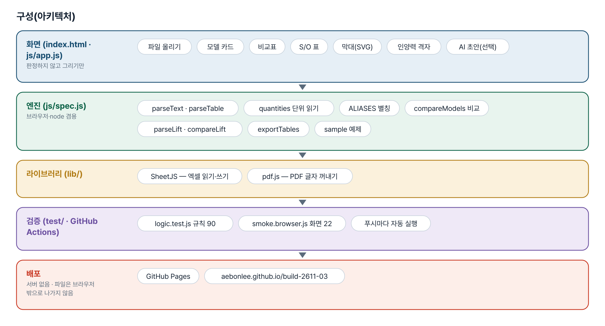
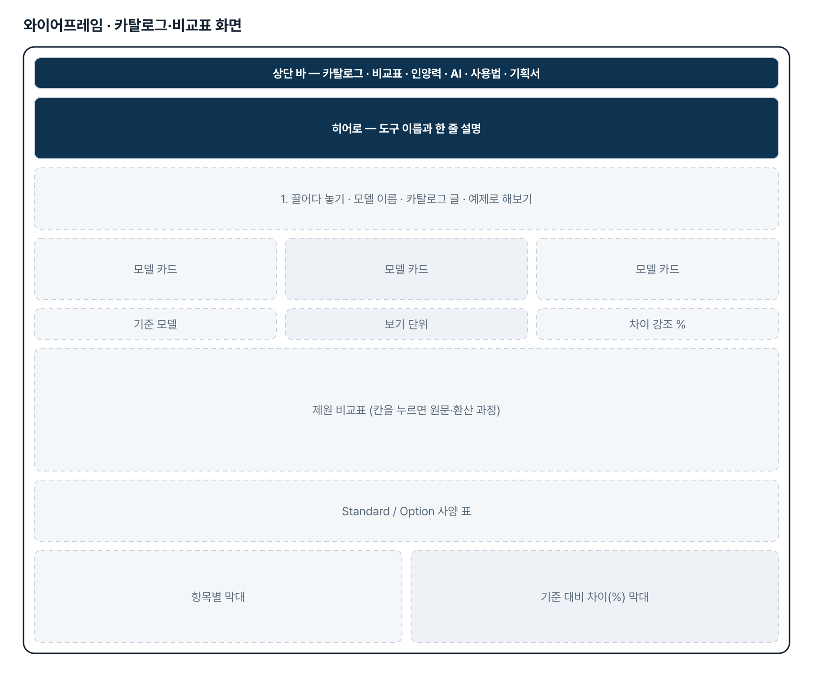
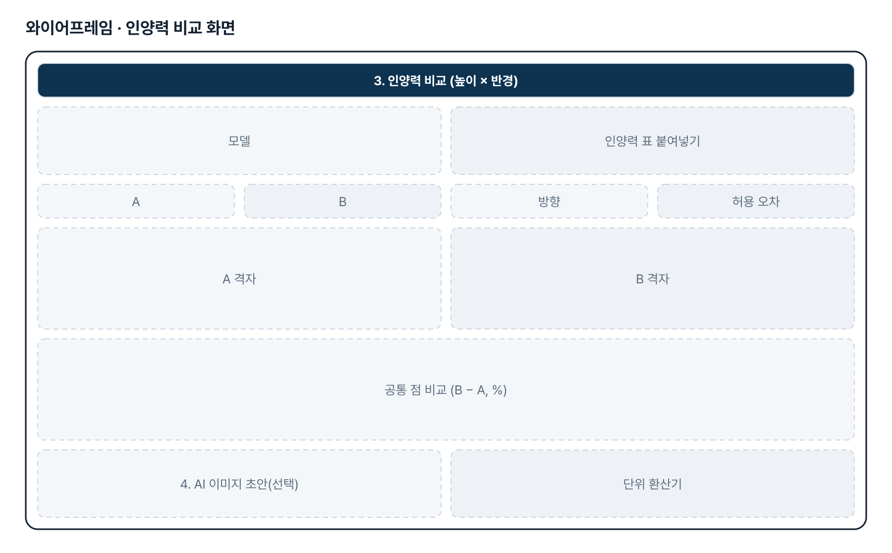
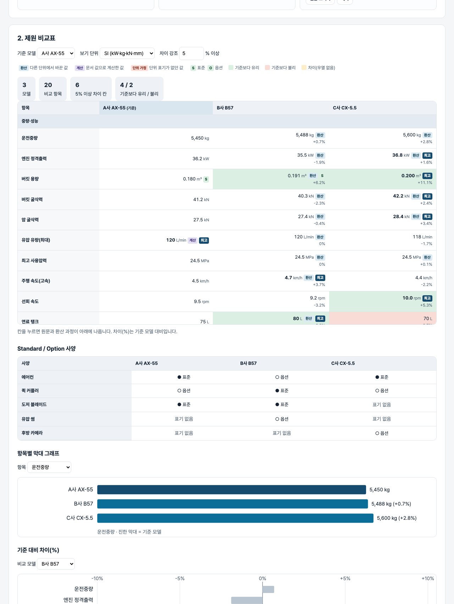

# 경쟁사 제원 비교 — 프로젝트 기획서 v1.0

- 기획: 조민규 · 작성일 2026-11-02 · 생성형 AI 업무자동화 전문가과정 · 2차수 프로젝트 03
- 바로 쓰기: https://build-2611-03.jobability.co.kr/
- 워드 판: `docs/기획서/build-2611-03_조민규_경쟁사제원비교_기획서_v1.0.docx`

## 개요

경쟁사 카탈로그(붙여넣기·글자 PDF·엑셀)의 제원을 표준 항목·표준 단위로 맞춰 모델별 비교표·차이 강조·막대 그래프·Standard/Option 표·인양력 격자 비교를 만들고 엑셀로 내보내는 도구입니다.

### 배경 · 현재 업무
- 신기종 개발 때마다 목표 톤급의 경쟁 모델 제원을 조사·정리·비교하는 일이 반복됩니다.
- 제원이 웹페이지와 PDF 카탈로그에 흩어져 있고, 제조사마다 항목 이름과 단위(hp·PS·lb·kgf·ft-in 등)가 다릅니다.
- 인양력은 이미지 표가 많고 제조사마다 표 구조(높이·반경·방향)가 달라 변환이 어렵습니다.
- Standard / Option 표기 방식이 제조사마다 달라 같은 양식의 엑셀로 반복 정리해야 합니다.

### 목표
- 카탈로그를 붙여 넣거나 올리면 제원을 표준 항목 19개와 표준 단위로 맞춥니다.
- 환산·계산·단위 가정 값을 문서 값과 구분해 보여 줍니다.
- 기준 모델 대비 차이를 계산해 강조하고 그래프로 보여 줍니다.
- 인양력 표를 높이 × 반경 격자로 정리해 두 모델의 공통 점을 비교합니다.
- 결과를 엑셀로 내보내 바로 씁니다.

## 요구사항과 구현

| 기획서 요구 | 구현 |
|---|---|
| 웹페이지·PDF 에 분산된 제원 수집 | 붙여넣기 · 글자 PDF(pdf.js, 줄 재구성) · 엑셀(가로 표·세로 표) |
| 장비 성능 제원(엔진 출력·굴삭력·유압 유량 등) | 표준 항목 10개 — 운전중량·정격출력·버킷 용량·버킷/암 굴삭력·유압 유량·사용압력·주행/선회 속도·연료 탱크 |
| 치수·작업범위 제원 | 표준 항목 9개 — 전장·전폭·전고·후방 선회반경·슈 폭·최대 굴삭 깊이/반경/높이·최대 덤프 높이 |
| 제조사별 형식을 표준 데이터로 변환 | 항목 별칭 표(ALIASES)·단위 10차원 환산·「단위: mm」 줄·범위 밖 값 경고, 화면에서 별칭 기억 |
| Standard / Option 구분 | (표준)(옵션)(Std)(Opt)●○·구분 열 → 대표값은 표준, 사양 줄은 S/O 표 |
| 이미지형 인양력 표를 비교 가능한 데이터로 | 높이 × 반경 격자(정면/측면·유압 한계·kg/lb·m/ft), 공통 점 비교, 이미지는 AI 초안(선택) 후 사람이 대조 |
| 비교표·시각화·Excel 자동 생성 | 기준 대비 차이(%)·유리/불리 강조, 막대 그래프 2종, 엑셀 7시트 |

## 주요 기능

- **카탈로그 읽기** — 붙여넣기·글자 PDF·엑셀을 읽어 모델 카드로 만듭니다. 읽지 못한 줄은 버리지 않고 남기며, 표준 항목에 짝지어 별칭으로 기억시킬 수 있습니다.
- **단위 환산** — hp·PS·lb·ton·lbf·kgf·tf·gpm·psi·bar·kgf/cm²·mph·yd³·gal·in·ft·ft-in 을 표준 단위로 바꾸고 환산·계산·단위 가정 꼬리표를 붙입니다.
- **제원 비교표** — 기준 모델 대비 차이(%)와 최고값을 표시하고, 칸을 누르면 원문과 환산 과정을 보여 줍니다. SI·영미 단위로 바꿔 볼 수 있습니다.
- **Standard / Option 표** — 에어컨·퀵 커플러 같은 사양을 제조사 표기와 상관없이 같은 줄에 모읍니다.
- **그래프** — 항목별 모델 막대와 기준 대비 차이(%) 막대를 SVG 로 그립니다.
- **인양력 비교** — 높이 × 반경 격자로 정리하고 허용 오차 안의 공통 점만 비교합니다. 보간하지 않습니다.
- **AI 이미지 초안(선택)** — 이미지 표를 글로 옮기는 초안만 만들고 「AI 초안 — 검토 필요」로 표시합니다. 키가 없어도 나머지 기능은 그대로 됩니다.
- **엑셀 내보내기** — 비교표·원문대조·표준_옵션·미인식_확인·인양력·인양력비교·안내 시트를 만듭니다.

## 처리 흐름(파이프라인)

1. **카탈로그 넣기** — 붙여넣기·글자 PDF·엑셀을 브라우저에서 읽음
2. **줄 나누기** — 항목 이름과 값을 가르고 PDF 글자를 줄로 재구성
3. **항목 인식** — 별칭 표로 표준 항목 19개에 짝짓기, 못 읽은 줄은 남김
4. **단위 환산** — 값·머리글·단위 줄 순으로 단위를 정해 표준 단위로
5. **S/O 구분** — 표준 값을 대표로, 옵션은 다른 사양으로, 사양 줄은 S/O 표로
6. **비교·강조** — 기준 모델 대비 차이(%), 유리·불리, 최고값
7. **인양력 격자** — 높이 × 반경으로 정리해 공통 점끼리 비교
8. **엑셀 보고** — 비교표·원문대조·인양력 시트로 내보내기

## 구성(아키텍처)

- **화면 (index.html · js/app.js)** — 파일 올리기 · 모델 카드 · 비교표 · S/O 표 · 막대(SVG) · 인양력 격자 · AI 초안(선택)
- **엔진 (js/spec.js)** — parseText · parseTable · quantities 단위 읽기 · ALIASES 별칭 · compareModels 비교 · parseLift · compareLift · exportTables · sample 예제
- **라이브러리 (lib/)** — SheetJS — 엑셀 읽기·쓰기 · pdf.js — PDF 글자 꺼내기
- **검증 (test/ · GitHub Actions)** — logic.test.js 규칙 90 · smoke.browser.js 화면 22 · 푸시마다 자동 실행
- **배포** — GitHub Pages · aebonlee.github.io/build-2611-03

## 화면 구성(와이어프레임)

## 규칙 · 판정 기준

- 표준 단위는 kW · kg · kN · L/min · MPa · km/h · rpm · m³ · L · mm, 인양력은 kg · mm 입니다.
- 단위는 값에 붙은 단위 → 항목 이름 괄호(머리글·단위 열) → 위쪽 「단위: …」 줄 순으로 정하고, 없으면 표준 단위로 가정해 경고합니다.
- 굴삭력 칸의 kg 은 kgf, lb 는 lbf 로 봅니다(차원은 항목이 정합니다).
- 한 칸에 여러 사양이 있으면 표준(Std) 값이 대표값입니다. 주행 속도는 저/고 중 큰 값입니다.
- 차이 강조는 기준 대비 |차이| ≥ 문턱(기본 5%)인 칸입니다. 우열이 없는 치수는 「차이」로만 표시합니다.
- 인양력은 높이·반경이 허용 오차(기본 100 mm) 안인 점끼리만 비교하고 보간하지 않습니다.

## 검증

- 계산 규칙 테스트 90개 · 화면 연기 테스트 22개 통과
- 「허용 오차 10 mm 면 짝이 0」 기대가 틀렸습니다(4000↔3993 은 7 mm 라 짝이 됨) — 기대값을 규칙대로 고쳤습니다.
- 되돌려 확인: 굴삭력 차원에서 kg(=kgf)을 빼면 해당 테스트가 실패합니다. lib/pdf.min.mjs 를 치우면 화면 테스트의 PDF 단계가 실패합니다.
- 화면 테스트: 예제 → 비교표·꼬리표·강조 → 원문 패널 → S/O 표 → 막대 → 영미 단위 → 인양력 공통 점 → 별칭 기억 → 엑셀 → 글자 PDF 읽기 → 360px 넘침 없음.

## 이번 판에서 하지 않는 것

- 목표 톤급의 경쟁 모델 자동 검색, 제조사 홈페이지 자동 수집은 하지 않습니다 — 카탈로그는 직접 올립니다.
- 이미지형 인양력 표는 AI 초안만 만들고, 사람이 원본과 대조해 확정합니다.
- PDF 읽기는 웹 주소로 열었을 때만 됩니다. 스캔 이미지 PDF 는 AI 나 붙여넣기를 씁니다.
- 소수점 쉼표 표기(0,18)는 읽지 않습니다.

## 다음 단계

- 기획자의 실제 카탈로그 표기로 ALIASES · FEATURE_ALIASES 보강
- 같은 높이의 반경 방향 인양력 곡선 그래프
- 톤급별 항목 범위로 단위 경고를 더 촘촘하게
- 사내 표준 양식에 맞춘 엑셀 내보내기

## 버전 이력

- **v1.0** (2026-11-02) — 첫 판 — 카탈로그 읽기·표준 항목·단위 환산·S/O·비교표·그래프·인양력 격자 비교·엑셀 내보내기 / 기획서 워드 판·파이프라인·아키텍처·와이어프레임 추가
